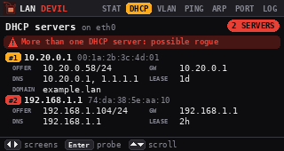
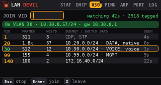
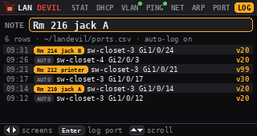
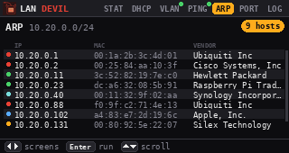

# LAN Devil -- CardputerZero build

**[landevil.com](https://landevil.com)** -- try the live demo in your browser.

The LAN Devil pocket network-ID tool as a CardputerZero APPLaunch app.
Plug the Cardputer's Ethernet port into a switch port and the home screen
shows link speed, your DHCP lease, and what you're plugged into -- switch
name, port, VLAN, management IP -- from LLDP/CDP. Ping (live latency
graph), ARP sweep (with MAC vendors) and a TCP port grid are one key away.

LAN Devil started as a Raspberry Pi build (Python + lldpd + e-paper) and
ESP32 firmware; the LLDP/CDP TLV parsing here is ported from the firmware
and extended with mgmt-address, 802.1, 802.3 and LLDP-MED TLVs. On the
CardputerZero the keyboard and screen are the whole interface.

 
 
 


## Screens

| Tab | What it does |
|---|---|
| **STAT** | Link + speed ladder + duplex, flap counter (kernel `carrier_changes`), IP/GW/DNS. Neighbor card: switch, port, native VLAN, mgmt IP, **PoE** (802.3af/at class + watts, LLDP-MED, CDP), **voice VLAN** (LLDP-MED / CDP), and the switch's own speed/duplex. Alerts on **speed/duplex mismatch**, half duplex, 10M links and recent flaps. |
| **DHCP** | Broadcasts one DHCPDISCOVER (no lease taken) and lists **every** server that offers: offered IP, gateway, DNS, lease, domain, TFTP/boot, relay. Two or more servers -> red **possible rogue** banner. |
| **VLAN** | `S` watches 802.1Q-tagged frames on a trunk (passive): per VLAN frames, hosts, guessed subnet, merged with what the switch advertises (native / voice / named VLANs). `Enter` **joins** the selected (or typed) VLAN: creates `eth0.N`, gets a DHCP lease, and DHCP/Ping/ARP/Port then run on that VLAN (header shows `V30`). `X` leaves (DHCPRELEASE + link removed); exiting the app always cleans up. No default route is added, so Wi-Fi/SSH are unaffected. |
| **PING** | Live RTT bar graph (lost = red X) + recv/loss/avg/min-max tiles. |
| **ARP** | Subnet sweep (capped /24) with MAC vendors. |
| **PORT** | TCP connect grid of 28 common services. |
| **LOG** | Every new switch+port is **auto-logged**; type a note ("Rm 214 jack B") + Enter to add a labelled row. CSV at `~/landevil/ports.csv` (owned by the desktop user even though the app runs under sudo). |

## Neighbor discovery: raw capture *and* lldpd

The store can't assume lldpd is installed, so the app captures LLDP
(EtherType 0x88CC) and CDP (802.3/SNAP) itself on AF_PACKET sockets.
Switches announce every 30-60 s, so on a fresh plug-in you wait up to a
minute (the status card shows a radar + 60 s bar while listening).

If lldpd **is** installed, the app also polls
`lldpcli -f json show neighbors` every 5 s and shows that neighbor
immediately, tagged `LLDP (lldpd)` / `cached`, until a fresh frame is seen
on the wire. Both coexist fine: packet sockets get their own copy of each
frame.

Raw capture, the DHCP probe, VLAN watch/join and the raw ARP sweep need
root. APPLaunch runs as the desktop user, not root, so the
launcher wrapper re-execs under passwordless `sudo` when the image allows
it (stock images do). Without it: neighbors come from lldpd, the ARP sweep
uses the kernel ARP table, and DHCP/VLAN say they need root.

## Files

| File | What |
|---|---|
| `landevil.py` | UI: screens, input, rendering (Pillow), `--preview` |
| `netdiag.py` | link/IP/gateway/DNS, LLDP/CDP parser (incl. 802.3 PoE/MAU, LLDP-MED, 802.1 VLAN names) + listener, lldpd reader, ping, ARP sweep, port scan |
| `dhcp.py` | raw-socket DHCP: rogue probe, one-shot lease (DORA), release |
| `vlan.py` | tagged-frame watcher (BPF + PACKET_AUXDATA), VLAN join/leave |
| `portlog.py` | the CSV port log |
| `ui.py` | palette, fonts, drawn icons/widgets |
| `device.py` | framebuffer (finds the ST7789 panel, never assumes fb0) and raw evdev keyboard -- no python3-evdev needed |
| `window.py` | desktop window backend for the uConsole (`--window`): Tk, scaled frame, keys mapped to the same keycodes |
| `assets/`, `packaging/icon.png` | logo and app icon |
| `packaging/build_deb.py` | builds the `.deb` (uses dpkg-deb if present, otherwise writes it in pure Python); `--target uconsole` for the desktop package |
| `deploy.sh` | build, scp and `apt install` on a device over SSH |
| `app-builder.json` | package + App Store listing metadata |
| `tests/` | parser/DHCP/VLAN/log tests with synthetic frames and lldpd JSON |

## Install

From the CardputerZero app store once it's listed. Until then, build and
install the package over SSH from any Linux/macOS machine:

```bash
./deploy.sh <user>@<cardputer-host>      # builds the .deb, copies it, apt installs it
```

It then shows up in the launcher. To run it without installing, copy the
folder to the device and run `sudo python3 landevil.py` (needs
`python3-pil python3-numpy fonts-dejavu-core`).

### uConsole (and other Linux desktops)

The same app runs fullscreen in a desktop window, scaled 4x to the
uConsole's 1280x720 screen. On a uConsole with the HackerGadgets AIO V2
board, its RJ45 port is the Compute Module's own `eth0`, which LAN Devil
picks automatically (`LANDEVIL_IFACE=<name>` overrides).

```bash
python3 packaging/build_deb.py --target uconsole        # -> build/landevil-uconsole_<ver>_all.deb
scp build/landevil-uconsole_*_all.deb <user>@<uconsole-host>:/tmp/
ssh <user>@<uconsole-host> 'sudo apt-get install -y /tmp/landevil-uconsole_*_all.deb'
```

Start it from the menu (Applications > Internet / System Tools > LAN Devil)
or run `landevil`. It re-runs itself as root (passwordless sudo, else a
pkexec password prompt) so LLDP/CDP capture, the DHCP probe and the ARP
sweep work. Same keys as on the Cardputer; hold Esc or close the window to
quit, F11 toggles fullscreen. `python3 landevil.py --windowed` runs it in a
normal window on any desktop for development.

## Develop off-device

```bash
python3 landevil.py --preview /tmp/ld      # renders the splash + all 7 screens with demo data
cd tests && python3 -m unittest test_netdiag test_v02
python3 packaging/build_deb.py                                # -> build/landevil_<ver>_all.deb
```

## Responsible use

DHCP probe, VLAN join, ARP sweep and port scan send traffic and are
labelled as such on screen. Get an OK before running them on a network you
don't administer. STAT and VLAN watch are passive (VLAN watch puts the port
in promiscuous mode while it runs).

## Contact

- General: hello@landevil.com
- Bugs and feature requests: [GitHub issues](https://github.com/x22j/landevil-cardputer-zero/issues)
- Security problems: security@landevil.com (see [SECURITY.md](SECURITY.md))

## License

MIT, see [LICENSE](LICENSE). LAN Devil is an independent project, not
affiliated with M5Stack.
