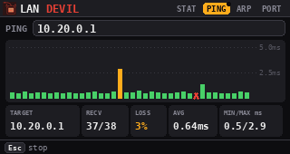
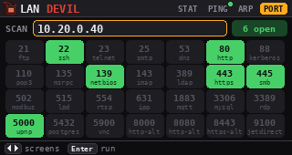

# LAN Devil -- CardputerZero build

The LAN Devil pocket network-ID tool as a CardputerZero APPLaunch app.
Plug the Cardputer's Ethernet port into a switch port and the home screen
shows link speed, your DHCP lease, and what you're plugged into -- switch
name, port, VLAN, management IP -- from LLDP/CDP. Ping (live latency
graph), ARP sweep (with MAC vendors) and a TCP port grid are one key away.

Lineage: the Pi build (`~/Documents/ld`, Python + lldpd + e-paper) is the
direct ancestor; the LLDP/CDP TLV parsing is ported from the S31 firmware
(`landevil-s31/main/lldp_cdp.c`), extended with mgmt-address and 802.1
port-VLAN TLVs. Here the keyboard and screen are the control plane, so the
BLE / Wi-Fi AP control page isn't needed.

 
 

## Keys

| Key | Does |
|---|---|
| Left / Right, Tab | switch screen (STAT, PING, ARP, PORT) |
| Enter | run ping / sweep / scan |
| type, Backspace | edit the target (prefilled with the gateway) |
| Up / Down | scroll the ARP table |
| Esc | stop the running probe, or back to STAT |
| hold Esc (0.8 s) | exit to the launcher (red bar fills along the bottom) |

## Neighbor discovery: raw capture *and* lldpd

The store can't assume lldpd is installed, so the app captures LLDP
(EtherType 0x88CC) and CDP (802.3/SNAP) itself on AF_PACKET sockets.
Switches announce every 30-60 s, so on a fresh plug-in you wait up to a
minute (the status card shows a radar + 60 s bar while listening).

If lldpd **is** installed (it is on your unit), the app also polls
`lldpcli -f json show neighbors` every 5 s and shows that neighbor
immediately, tagged `LLDP (lldpd)` / `cached`, until a fresh frame is seen
on the wire. Both coexist fine: packet sockets get their own copy of each
frame.

Raw capture and the ARP sweep need root (CAP_NET_RAW). APPLaunch runs as
root and so do its children, so that's automatic when launched from the
launcher; run by hand as `pi`, the status card says it needs root.

## Files

| File | What |
|---|---|
| `landevil.py` | UI: screens, input, rendering (Pillow), `--preview` |
| `netdiag.py` | link/IP/gateway/DNS, LLDP/CDP parser + listener, lldpd reader, ping, ARP sweep, port scan |
| `device.py` | framebuffer (finds `fb_st7789v`, never assumes fb0) and raw evdev keyboard -- no python3-evdev needed |
| `assets/logo120.png`, `packaging/icon.png` | tinted from `branding/landevil-logo-concept-edited.jpeg` |
| `packaging/build_deb.py` | builds the `.deb` (uses dpkg-deb if present, otherwise writes it in pure Python) |
| `deploy.sh` | build, scp, `apt install` on the device, restart APPLaunch |
| `app-builder.json` | package + App Store listing metadata |
| `tests/test_netdiag.py` | parser tests with synthetic LLDP/CDP frames and lldpd JSON |

## Try it on your Cardputer (no store needed)

```bash
./deploy.sh pi@<cardputer-ip>
```

Or by hand on the device: copy the folder over and run
`sudo python3 landevil.py` (needs `python3-pil python3-numpy fonts-dejavu-core`).

## Develop off-device

```bash
python3 landevil.py --preview /tmp/ld      # renders splash + 4 store screenshots
python3 -m unittest tests/test_netdiag.py
```

## Package / publish

```bash
python3 packaging/build_deb.py --maintainer "Your Name <you@example.com>"
# -> build/landevil_0.1.0_all.deb   (Architecture: all -- pure Python)
```

Publishing goes through `czdev publish` (CardputerZero AppBuilder) or the
web portal at dev.cardputer.cc. See `PUBLISH.md` for what's still to fill
in. First release of a new app needs a short video of it running on a real
device posted on the publish PR.

## Responsible use

ARP sweep and port scan send active traffic and are labelled as such on
screen. Get an OK before running them on a network you don't administer;
the passive status screen never transmits anything.
